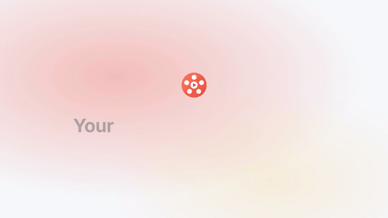

# make-promo-reel



An [Agent Skill](https://agentskills.io) that turns a web app into a
10–30 second promo video: real screen recordings of the app in use, filled with believable demo
data, finished with SaaS-launch-style motion graphics, and rendered to MP4.

> "make a 20s promo of this app for the top of our landing page"

The agent runs your app in an isolated copy, builds a demo world, storyboards three or four
moments for your approval, films them with Playwright, then composes and renders the video with
[Remotion](https://www.remotion.dev/). It adds a browser or phone frame, kinetic captions, one
restrained payoff zoom, a branded intro and an end card with a call to action. It can also film a
prototype or mockup (an HTML file) when there's no app yet.

## What you get

- **16:9, 1:1 or 9:16** cuts from one set of footage: landing-page hero, feed post, Stories/Reels.
  Each cut renders to MP4, and to a GIF for READMEs and docs.
- **Your app's own look.** It picks up fonts, colors, logo, mascot art and content photos from
  the repo, or from a design system, CSS/HTML file or media you supply.
- **A demo world that feels lived-in**: one protagonist, a small cast, specific content,
  recent timestamps. It also checks that no real teammates appear on screen.
- **Sound**: UI sound effects synthesized on install, and a curated royalty-free music library
  (Mixkit Free License, no attribution required).
- **Checks before you see it**: a contact sheet with pacing warnings and a beat report, a
  loudness check against the −14 LUFS social target, and optional parallel reviewers for
  readability, pacing and brand.
- **No surprises on camera**: chat widgets, cookie banners and "staging" ribbons are hidden
  during capture, and nothing is filmed until you approve the storyboard. That gate holds even
  when the skill runs as a subagent.
- **A reel folder you can re-cut**: the MP4s, contact sheets, a README with the shot list and
  an asset/license table, and everything needed to change copy or timing in about a minute
  without re-filming.

## Install

**Claude Code plugin** (adds the skill and keeps it updatable):

```
/plugin marketplace add bdebut01/make-promo-reel
/plugin install make-promo-reel@make-promo-reel
```

**skills CLI** (any agent that reads `SKILL.md`):

```sh
npx skills add bdebut01/make-promo-reel
```

**By hand**: copy `skills/make-promo-reel/` into your agent's skills folder. For Claude Code
that's `~/.claude/skills/` (personal) or `.claude/skills/` (one project); other agents
document their own.

### Which agents

It follows the open [Agent Skills](https://agentskills.io) format, so any agent that loads
`SKILL.md` skills and can run shell commands can use it. It was written and tested in
**Claude Code**. A few steps work best there, and each has a fallback elsewhere
(`references/environments.md`):

| Feature | In Claude Code | Elsewhere |
|---|---|---|
| Servers for the app copy | the Bash tool's background tasks | the agent's own background tasks, or a start script the user runs |
| Browser inside a sandbox | `scripts/box` (Docker) | usually not needed: Chromium runs on the host |
| Parallel review of the cut | subagents | one reviewer at a time |
| claude.ai artifacts as a design source | Claude's Artifact tool | an exported HTML, tokens or font files |

## Requirements

Works on **macOS, Linux and Windows** (10 or later). The skill's own scripts are plain Node,
and CI runs their tests on all three.

- **Node 20+** and **git** (and `curl` for the music library, which Windows 10+ also ships).
- Whatever your app needs to run locally (its database, its language runtime).
- **Chromium**, through one of:
  - the host: the skill runs `npx playwright install chromium` in its studio folder, or
  - **Docker**, via the bundled `scripts/box` (macOS and Linux). You need this only when the
    agent runs in a sandbox where Chromium can't launch, as in Claude Code's sandbox on macOS.
    `box` runs the browser in the official Playwright image and mounts only the one folder
    it's given.

No ffmpeg, Python or other system-wide installs are needed: Remotion bundles its own ffmpeg.

### Using it inside a sandbox (Claude Code and similar)

Chromium can't start inside Claude Code's sandbox on macOS, so the skill uses `box` there. To let it run without a prompt
each time, allow the script in your settings (adjust the path to where the skill is installed):

```json
{ "permissions": { "allow": ["Bash(/Users/you/.claude/skills/make-promo-reel/scripts/box:*)"] } }
```

`box` runs outside the sandbox, so it is its own fence: it mounts only folders under the
reels folder, `$TMPDIR`, Claude's temp folder or `$BOX_ROOTS`. Read `scripts/box` before
allowing it; it's short on purpose.

## Configuration

| Variable | Default | What it does |
|---|---|---|
| `PROMO_REELS` | `~/promo-reels` | Where reel folders are created. Never inside the app's checkout. |
| `PROMO_MUSIC_CACHE` | `$PROMO_REELS/_music` | Where music beds are downloaded once and reused. |
| `BOX_ROOTS` | (none) | Extra colon-separated folders `box` may mount. |
| `BOX_IMAGE` | `mcr.microsoft.com/playwright:v1.63.0-noble` | The container image `box` runs. Keep its Playwright version in step with `template/package.json`. |

## Safety

Making a promo means wiping and reseeding a database many times. The skill is built so that
this can't reach your data:

- It films a **disposable copy** of your app (`git clone --local` or `git archive`). The copy
  has its own database and ports, and test-mode or console backends for email, payments and
  SMS. It never touches your checkout, your database, your running servers or your branches.
- Every destructive command goes through **`scripts/guard.mjs`**. The guard resolves symlinks
  and `..` and refuses any path outside the reel's workspace or inside your checkout. It also
  refuses any database name that doesn't end in `_promo`.
- It never uses production keys, even read-only ones.
- It never puts identifiable real people on screen. It checks demo people against the repo's
  git authors, and flags third-party IP (film stills, other brands) in media you supply.
- It asks before downloading stock photos, and it downloads music only from the library's own
  licensed source.

## How it works

```
skills/make-promo-reel/
  SKILL.md                 the workflow: intake → run in isolation → demo world →
                           storyboard → capture → compose → deliver
  references/              loaded on demand: motion language, running apps per stack,
                           demo data, design sources, sound and output, environments
                           (Windows, sandboxes, agent features)
  scripts/
    capture.mjs            Playwright recorder: crisp screencast frames + a cursor/click log
    guard.mjs              refuses destructive targets outside the reel's workspace
    slim.mjs               shrinks a finished reel to tens of MB, with a rebuild script
    port.mjs, serve.mjs    check, wait on and stop app ports; serve a design to film
    box                    run a browser command in a one-folder Docker container (bash)
    music.mjs              pick, fetch and level a bed from library/music.json
    design-tokens.mjs      pull colors, fonts and radius out of CSS/HTML/token JSON
    avatars.mjs            initials-on-gradient profile pictures
  template/                the Remotion "studio" copied into each reel; promo.json drives it
  library/music.json       ten curated Mixkit tracks with mood, energy, BPM and loudness
  evals/evals.json         eval templates (landing hero, Stories, LinkedIn, design system)
  tests/                   node --test, for the scripts above
```

The video is described by `promo.json` (schema: `template/src/types.ts`). It lists an intro,
shots that point at captured clips with captions, trims and zoom, and an end card. The studio
reads the capture's click log to draw the cursor and aim the zoom.

## Licensing

**This skill** is MIT-licensed.

**Remotion**, which renders the video, has its own
[license](https://github.com/remotion-dev/remotion/blob/main/LICENSE.md). It's free for
individuals, non-profits and for-profit companies with up to 3 employees. Larger companies
need a [Remotion Company License](https://www.remotion.pro/license). The skill mentions this at
intake when the request looks like it's for a larger company.

**Music:** `library/music.json` lists tracks by URL only. Nothing is redistributed. Tracks are
downloaded from Mixkit at use time under the
[Mixkit Stock Music Free License](https://mixkit.co/license/#musicFree): free for commercial
use, no attribution required, and the files may not be redistributed as-is. Each reel's README
records which track it used.

## Related projects

- [remotion-dev/skills](https://github.com/remotion-dev/skills): Remotion's official skills for
  writing Remotion code. A good companion when you customize the studio's components.
- [digitalsamba/claude-code-video-toolkit](https://github.com/digitalsamba/claude-code-video-toolkit):
  a broader video workspace (voiceover, AI music, explainers).
- [heygen-com/hyperframes](https://github.com/heygen-com/hyperframes): launch videos rendered
  from HTML, built from a URL or brief rather than live recordings.

This skill focuses on one thing those don't do: filming your real, running app in a safe
isolated copy, with a believable demo world, and cutting it into a finished promo.

The GIF at the top was made with the skill itself: a fictional app ("Weekly") filmed and cut by
the normal pipeline, shown playing after a mock terminal session.

## Contributing

Contributions are welcome. New stack notes in `references/running-apps.md`, more moods, better
camera work and eval results are especially useful. See [CONTRIBUTING.md](CONTRIBUTING.md).

## License

[MIT](LICENSE)
